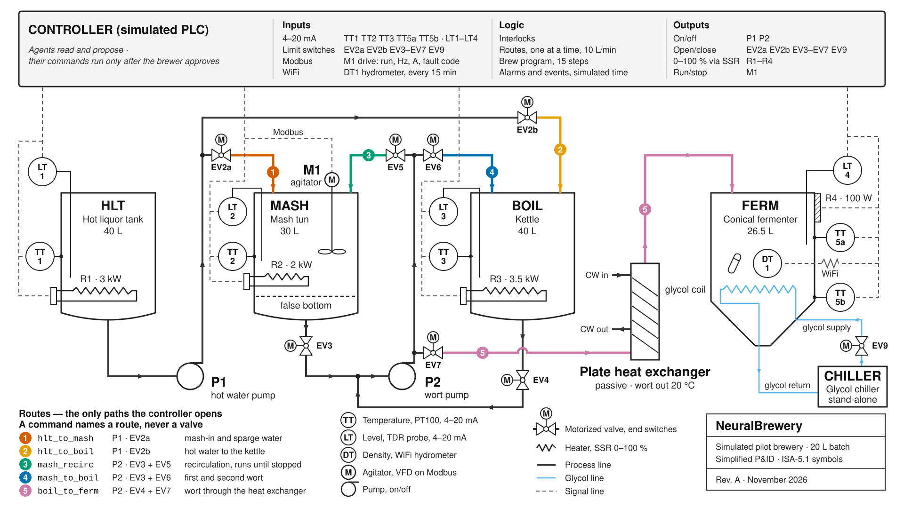

# NeuralBrewery


Un agente AI per un birrificio simulato. Legge l'impianto, trova la causa di un guasto e
propone al birraio il pulsante da premere. Lo preme solo l'esecutore, e solo dopo che il
birraio ha approvato: l'approvazione è codice, non una decisione del modello. Ogni proposta
passa da un guardrail, e ogni passaggio resta nell'audit.

Si prova tutto da una dashboard, con Docker e una chiave API. È il progetto finale del corso AI.

## In un minuto

```
impianto simulato: controllore, interlock, sicurezza cablata
   │ letture, allarmi, storico
   ▼
agente impianto ◀──────── le decisioni passate del birraio: la memoria
   │ una diagnosi e, se serve, un pulsante
   ▼
guardrail ◀────────────── propongono da qui anche il birraio e i client MCP
   │ fuori dai limiti: bloccata, con il motivo
   ▼
coda e audit, in Postgres
   │
   ▼
il birraio, dalla dashboard ──▶ rifiuta, con il motivo
   │ approva, con il suo token
   ▼
esecutore, l'unico codice che comanda
   │
   ▼
controllore: i suoi interlock possono ancora dire di no
```

- **Un agente solo, con privilegio minimo.** Legge l'impianto con i suoi tool e consegna una
  diagnosi: il componente, se è un guasto di misura o di processo, le verifiche da fare a mano e,
  al più, un pulsante. Non preme niente.
- **L'approvazione è codice.** La proposta aspetta in coda. Approvare chiede un token che
  l'agente non vede mai. Poi l'esecutore preme il pulsante, e il controllore lo accetta o lo
  rifiuta con i suoi interlock.
- **La memoria sono le decisioni del birraio.** Prima di proporre, l'agente legge com'è finita
  ogni sua proposta recente: approvata o rifiutata, e perché. Non ripropone un pulsante
  rifiutato per la stessa causa. Le decisioni stanno in Postgres, e restano dopo un riavvio.
- **Due fornitori.** Lo stesso agente gira su Claude, il default e quello della demo, o su
  Gemini Flash-Lite, scelto da un'impostazione. Gli eval li confrontano.
- **Un server MCP.** Un altro host, come Claude Code, legge lo stesso impianto e propone nella
  stessa coda. Non approva e non comanda.

### L'impianto



Un birrificio pilota per cotte da 20 L: la vasca dell'acqua calda (HLT), il tino, il
bollitore e il fermentatore.

- **Tra l'AI e l'impianto c'è un controllore simulato**, come un PLC. Conosce solo i segnali
  dei dispositivi, quindi una sonda guasta lo inganna.
- **I comandi sono pulsanti ad alto livello**: percorsi predefiniti, quantità e setpoint, mai
  una valvola alla volta. Un programma fa tutta la cotta in 15 passi.
- **Il controllore non riparte da solo.** Ciò che un interlock ferma resta fermo, con il suo
  allarme, finché qualcuno non riarma.
- **La sicurezza cablata sta fuori dal controllore.** Se la temperatura vera sale troppo, K1
  toglie corrente alle resistenze.
- **Il tempo è simulato**, e si muove solo a comando. Stesso seed e stesse azioni danno lo
  stesso impianto.

Tutto il resto, dai guasti iniettabili al programma della cotta: [docs/impianto.md](docs/impianto.md).

## Accenderlo

Serve:
- Docker, con Compose v2 (`docker compose version`);
- una chiave API di Anthropic, per la diagnosi. Senza chiave tutto il resto funziona, e la
  diagnosi risponde 503. Con una chiave Gemini, gratis: [sotto](#con-gemini-invece-di-claude).

Python non serve.

```bash
git clone https://github.com/Prgmturi/NeuralBrewery.git
cd NeuralBrewery
cp .env.example .env
```

Apri `.env` e scrivi la chiave dopo `ANTHROPIC_API_KEY=`. Il file resta fuori da git e dalle
immagini. Poi:

```bash
docker compose up --build --wait
```

La prima volta costruisce due immagini e scarica Postgres e Keycloak: qualche minuto. Il
comando torna quando ogni servizio è pronto. Apri http://localhost:8501: è la dashboard del
birraio.

| Servizio | Dove | Che cos'è |
|---|---|---|
| `dashboard` | http://localhost:8501 | La dashboard del birraio, da cui si fa la demo |
| `api` | http://localhost:8000, la documentazione su `/docs` | L'impianto simulato, l'agente, la coda e il server MCP su `/mcp` |
| `migrate` | | Porta il database all'ultima migrazione, poi esce |
| `db` | `localhost:5433` | Postgres: la coda delle proposte e l'audit |
| `keycloak`, `keycloak-db` | http://localhost:8080 | Il login del template da cui il progetto è nato: c'è, ma la demo non lo usa |

È lo stack di sviluppo:
- il token di approvazione è `brewer-dev-token`, ed è pubblico. La dashboard lo ha già;
- i comandi della simulazione sono accesi: muovere il tempo, iniettare e togliere guasti;
- API e dashboard rispondono solo su 127.0.0.1, non sulla rete.

Con una porta già occupata, cambiala in `.env`: `SERVER_PORT` per l'API, `DATABASE_PORT`,
`KEYCLOAK_PORT`, e per la dashboard una riga in più, `DASHBOARD_PORT=`. Gli indirizzi sopra
cambiano con loro.

Spegnere e ripartire:

```bash
docker compose down           # spegne; la coda resta, nel volume del database
docker compose down -v        # spegne e cancella i volumi: si riparte con la coda vuota
docker compose restart api    # un impianto nuovo, dalla partenza; la coda resta
```

### Con Gemini invece di Claude

In `.env` scrivi `AGENT_PROVIDER=openai_compat`, e la chiave di Google AI Studio dopo
`OPENAI_COMPAT_API_KEY=`. Poi di nuovo `docker compose up --build --wait`. Il modello è
`gemini-3.5-flash-lite`, sul piano gratuito. La demo dal vivo è provata su Claude; su Gemini
girano gli eval.

## La demo dalla dashboard

Nella barra a sinistra il birraio:
- scrive il suo nome, che l'audit registra;
- propone un pulsante, come `start_program`;
- muove la simulazione: il tempo e i guasti.

Nella pagina, dall'alto:
- **l'esito dell'ultima azione**, a parole, compresi i rifiuti dell'API;
- **l'impianto**: tempo simulato, programma e passo, allarmi del controllore, giudizi del
  sorvegliante, letture;
- **la diagnosi**: il pulsante *Diagnostica adesso*, poi la spiegazione dell'agente, le
  verifiche a mano, la proposta, e ogni passo dell'agente con i suoi token;
- **la coda**, dalla proposta più recente: chi l'ha fatta (`agent`, `mcp` o `user`), perché,
  ogni evento, e *Approva* e *Rifiuta* per quelle in attesa.

La pagina non si aggiorna da sola: si ridisegna quando premi o scrivi qualcosa.

Il giro della demo racconta una cotta in cui la sonda TT1 si rompe due volte:
1. Il birraio propone e approva `start_program`: la cotta parte.
2. TT1 si rompe. Il controllore sospende la regolazione della HLT, e il programma va in pausa.
   Tolto il guasto, il blocco resta, e il suo testo finisce con *(bloccato: serve reset)*.
3. *Diagnostica adesso*: l'agente riconosce un guasto di misura su TT1 e propone `reset`. Il
   birraio approva, poi propone e approva `resume_program`, e la cotta riprende.
4. TT1 si rompe di nuovo. L'agente ripropone `reset`, perché l'ultima volta era stato approvato.
   Questa volta il birraio rifiuta, con il motivo: la sonda ha un contatto intermittente, e va
   sostituita.
5. Alla diagnosi successiva l'agente non propone niente, e cita il rifiuto con il suo motivo. Se
   ne ricorda anche dopo `docker compose restart api`, con l'impianto ripartito da zero.

I passi esatti, con i secondi da avanzare e i guasti da iniettare, sono in
[The round of the speech](docs/development.md#the-round-of-the-speech), in inglese. Su Claude
le tre diagnosi costano circa 8 centesimi, in tutto. Per ripartire con la coda vuota:
`docker compose down -v`, poi di nuovo `docker compose up --build --wait`.

Sempre in `docs/development.md`:
- [il server MCP con Claude Code](docs/development.md#the-mcp-server-for-the-video): la
  proposta compare nella coda della dashboard come `mcp`. Nel discorso si mostra con un video;
- [l'API a mano, con `curl`](docs/development.md#the-api-by-hand-as-a-reference): ciò che la
  dashboard chiama.

## I requisiti del corso, e dove sono

| Requisito | Come | Dove |
|---|---|---|
| Tool calling | L'agente legge con `read_plant`, `read_events`, `read_history`, `run_watcher` e `read_decisions`, e consegna la diagnosi con `submit_diagnosis`, i cui argomenti controlla pydantic | [tools.py](src/neuralbrewery/features/agents/tools.py) |
| Client multi-provider | Lo stesso agente su Claude (`claude-sonnet-5-5`) o su Gemini (`gemini-3.5-flash-lite`, con un client compatibile OpenAI), scelto da `AGENT_PROVIDER` | [adapters/claude/](src/neuralbrewery/adapters/claude/), [adapters/openai_compat/](src/neuralbrewery/adapters/openai_compat/) |
| Memoria persistente | Le decisioni del birraio sulle ultime 10 proposte dell'agente, lette dalla coda in Postgres con `read_decisions`. Restano dopo un riavvio | [la porta `DecisionReader`](src/neuralbrewery/core/approvals/protocols.py), [chi la implementa](src/neuralbrewery/features/approvals/api/decisions.py) |
| Architettura giustificata | Un agente solo, con privilegio minimo: legge e propone. Comanda solo l'esecutore, dopo guardrail, coda e approvazione. Il multi-agente viene dopo il corso | [docs/decisioni.md](docs/decisioni.md#scelte-fatte), la voce "Agenti" |
| Flusso fisso (DagPipeline) | Non serve: la diagnosi su richiesta è un agente con i tool. Dopo il corso, la diagnosi su allarme diventa un flusso fisso | [docs/decisioni.md](docs/decisioni.md#scelte-fatte) |
| Guardrail | Ogni proposta, dell'agente, del birraio o di un client MCP, passa da un controllo in codice prima della coda: un pulsante del pannello, i suoi argomenti e nessun altro, setpoint e litri nei limiti. Fuori dai limiti è bloccata, e il blocco resta nell'audit. Il primo livello sono gli interlock del controllore | [guardrail.py](src/neuralbrewery/features/approvals/domain/guardrail.py) |
| Audit trail | Ogni proposta, decisione ed esecuzione in una tabella a cui si aggiunge e basta: un trigger rifiuta UPDATE, DELETE e TRUNCATE. Ogni passo dell'agente nel tracing di datapizza (`ContextTracing`): la dashboard mostra quello dell'ultima diagnosi, e gli eval lo scrivono su file | [la migrazione](alembic/versions/00b0ef650519_create_approval_events_table.py), [plant_agent.py](src/neuralbrewery/features/agents/plant_agent.py) |
| Eval pass/fail | Cinque scenari di guasto con seed fisso. Il verdetto è codice, sulla diagnosi e sulla traiettoria: nessun LLM fa da giudice. Girano su Claude e su Gemini, e una tabella li confronta | [tests/evals/](tests/evals/) |
| README che gira | Questo file: Docker e una chiave API | [Accenderlo](#accenderlo) |
| RAG (facoltativo) | Dopo il corso | [Dopo il corso](#dopo-il-corso) |
| Un server MCP usato da un altro host | `/mcp` nell'API: quattro tool di lettura e `propose_action`, che mette in coda come `mcp`. Claude Code lo usa | [mcp_server.py](src/neuralbrewery/features/agents/mcp_server.py) |

## Com'è fatto

Il codice sta in `src/neuralbrewery/`:

| Dove | Che cosa |
|---|---|
| [adapters/plant_sim/](src/neuralbrewery/adapters/plant_sim/) | L'impianto simulato: processo, dispositivi, controllore con interlock, programma e allarmi. Python puro |
| [core/plant/](src/neuralbrewery/core/plant/) | Il vocabolario, le tre porte del controllore e il sorvegliante, a regole fisse |
| [features/agents/](src/neuralbrewery/features/agents/) | L'agente impianto, i suoi tool, l'endpoint della diagnosi e il server MCP |
| [features/approvals/](src/neuralbrewery/features/approvals/) | Guardrail, coda, audit ed esecutore |
| [features/plant/](src/neuralbrewery/features/plant/) | La lettura dell'impianto e, solo in sviluppo, i comandi della simulazione |
| [adapters/claude/](src/neuralbrewery/adapters/claude/), [adapters/openai_compat/](src/neuralbrewery/adapters/openai_compat/) | I client dei due fornitori |
| [dashboard/](src/neuralbrewery/dashboard/) | La dashboard: un client HTTP dell'API, che non importa niente dell'app |
| [bootstrap.py](src/neuralbrewery/bootstrap.py) | Costruisce tutto, e dà a ognuno solo la porta che gli serve |

Il controllore ha tre porte, e ognuno riceve solo la sua:
- `PlantReader`, per leggere: l'agente, il server MCP, il sorvegliante;
- `PlantCommander`, per premere i pulsanti: solo l'esecutore, dopo l'approvazione;
- `SimulationControl`, per il tempo e i guasti: solo test, eval e demo.

Gli import scendono: feature e adapter non si importano a vicenda, e la CI lo controlla con
import-linter. L'agente è scritto con datapizza-ai, la dashboard con Streamlit, l'API con
FastAPI.

## Limiti noti

- **La memoria è un consiglio, non una regola.** Se la causa è "la stessa" lo giudica il
  modello, e il guardrail non ferma un pulsante già rifiutato. Ricorda solo le diagnosi che
  hanno proposto un pulsante.
- **Il modello non è deterministico.** Sul codice finale gli eval passano tutti e cinque, su
  Claude e su Gemini. In quattro giri, però, S3 su Claude e S2 su Gemini hanno sbagliato una
  volta.
- **`/mcp` e la diagnosi non chiedono login.** Chi raggiunge l'API legge l'impianto, mette
  proposte in coda e spende diagnosi; approvare no, serve il token. Per questo API e dashboard
  rispondono solo su 127.0.0.1. Postgres e Keycloak invece sono pubblicati su tutte le
  interfacce, con le password di sviluppo.
- **L'impianto vive nel processo dell'API.** Un riavvio lo fa ripartire da zero, e muovere il
  tempo blocca l'API per circa 0,16 s per ora simulata.
- **La dashboard non conta i token scritti nella cache**: il costo di una diagnosi lo misurano
  gli eval, da 1 a 3 centesimi su Claude.
- **Dopo un `reset` approvato** l'allarme resta sulla pagina fino al prossimo avanzamento del
  tempo: lo toglie il controllore, al suo giro.

Gli altri: [docs/decisioni.md](docs/decisioni.md#ancora-aperte).

## Dopo il corso

- RAG sui manuali dei componenti, tutti pubblici ed elencati in
  [manuals/manifest.toml](manuals/manifest.toml): ricerca ibrida e rerank, valutata con RAGAS;
- più agenti: un orchestratore che parla con il birraio, l'agente impianto, l'unico che propone
  azioni, e un analista per dati e calcoli. Chi legge testo non fidato non deve poter proporre;
- la diagnosi su allarme come flusso fisso;
- l'impianto in un servizio a sé, con il tempo che scorre, e lo storico su Postgres con Grafana;
- red teaming, eval in CI, l'approvazione con un'identità verificata, un'interfaccia completa.

La roadmap: [docs/decisioni.md](docs/decisioni.md#roadmap).

## Test ed eval

Facoltativi: servono [uv](https://docs.astral.sh/uv/) 0.13 o più recente, che installa da sé
Python 3.13.

```bash
uv sync
uv run pytest                                        # i test: niente rete, niente database
uv run pytest -m eval                                # l'agente su Claude, cinque scenari: circa 15 centesimi
AGENT_PROVIDER=openai_compat uv run pytest -m eval   # lo stesso su Gemini, gratis: circa 4 minuti
```

Gli eval leggono la chiave dal `.env`. In PowerShell, prima dell'ultimo comando:
`$env:AGENT_PROVIDER = 'openai_compat'`. Che cosa verificano e dove scrivono i risultati:
[Eval of the agents](docs/development.md#eval-of-the-agents). I test di integrazione, quelli
end-to-end e la CI: [Tests](docs/development.md#tests).

## Per chi sviluppa

- Le regole del progetto e come ci si lavora: [AGENTS.md](AGENTS.md).
- Strumenti, test, CI e rilasci: [docs/development.md](docs/development.md).
- Ogni scelta, con il suo perché: [docs/decisioni.md](docs/decisioni.md).

---

Fatto da [Prgmturi](https://github.com/Prgmturi) · [Claude](https://claude.ai) è stato un ottimo compagno di squadra 🤖
